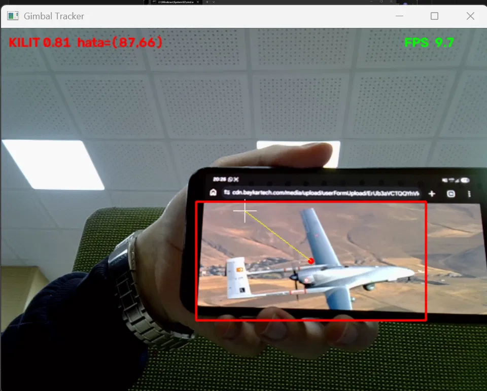
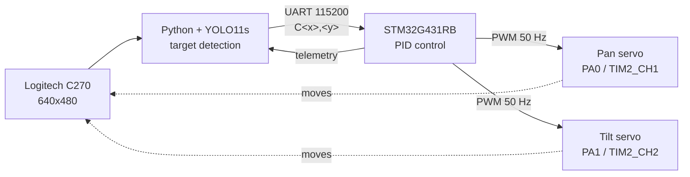

# STM32 Gimbal Target Tracker

Autonomous target detection and tracking on a 2-axis pan-tilt gimbal.
A camera detects a fixed-wing UAV with a YOLO11 model, sends the target position over UART,
and an STM32 runs a PID loop that keeps the target in the center of the frame.



Demo: [first pan tracking test (video)](docs/first_tracking_pan.mp4)

> Work in progress. Pan tracking works end to end; tilt axis is waiting on a mechanical fix.
> Next steps: FreeRTOS, Qt ground station, and moving the vision part onto a T3 Gemstone O1 board.

## Why I built this

I was the captain of our university's TEKNOFEST Combat UAV team. In the competition, locking onto
another aircraft is done in software on the flight computer, and I wanted to understand the full chain
myself: from the camera image down to the PWM signal that moves a motor. At TEKNOFEST an engineer
told us to focus on target detection, lock-on and autonomous tracking, so I picked this as my
personal embedded project. The commit history shows how the hardware and firmware side grew step by step.

---

## How it works



1. The camera sits on top of the gimbal, so every servo move changes what the camera sees (closed loop).
2. `vision/hedef_takip.py` grabs a frame, runs the detector and picks the box with the highest confidence.
3. The box center is sent to the STM32 as `C<x>,<y>`. If nothing is detected it sends `N`.
4. The STM32 computes the error from the image center (320, 240) and updates the servo angles with PID.
5. When the target is centered, the error goes to zero and the gimbal stops.

## Hardware

| Part | Notes |
|---|---|
| STM32 NUCLEO-G431RB | Cortex-M4, 170 MHz |
| 2x SG90 servo + pan-tilt bracket | calibrated to 500-2500 us for 0-180 deg |
| Logitech C270 | UVC, 640x480 used |
| 5 V powerbank | servos only, common GND with the Nucleo |
| Laptop | runs the detector for now (~10 FPS on CPU) |

### Wiring

| Signal | Pin |
|---|---|
| Pan servo signal | PA0 (TIM2_CH1) |
| Tilt servo signal | PA1 (TIM2_CH2) |
| UART to PC | LPUART1, PA2 (TX) / PA3 (RX), over ST-Link virtual COM |
| Servo power | external 5 V, **not** from the Nucleo |
| GND | external supply GND tied to Nucleo GND |

Servos are powered separately because their current spikes can drop the board voltage and reset the MCU.

## Firmware (STM32)

**PWM.** TIM2 runs from 170 MHz with PSC = 169 and ARR = 19999:

```
170 MHz / (169 + 1) = 1 MHz  ->  1 tick = 1 us
1 MHz / (19999 + 1) = 50 Hz  ->  20 ms period
```

So the CCR value is directly the pulse width in microseconds. One timer drives both servos on two channels.

**UART.** Receive is interrupt driven (`HAL_UART_Receive_IT`, one byte at a time). The ISR only collects
characters into a buffer and sets a flag when it sees `\r` or `\n`; parsing is done in the main loop.

**Control loop.**
- In camera mode the PID step runs **only when a new measurement arrives**. The camera gives ~10 FPS;
  running PID at 50 Hz on the same old measurement would correct the same error several times and overshoot.
- If no measurement comes for 500 ms the target is marked lost and the servos hold their position.
- Angles are clamped to mechanical limits (pan 20-160, tilt 45-135) so the bracket does not hit itself.
- No `HAL_Delay` in the loop; timing uses `HAL_GetTick()` differences (safe across the 32-bit wrap).

### UART protocol

| Command | Direction | Meaning |
|---|---|---|
| `C<x>,<y>` | PC -> MCU | target center in pixels (640x480) |
| `N` | PC -> MCU | no target in frame |
| `W<pan>,<tilt>` | PC -> MCU | simulated target, for testing PID without a camera |
| `K<n>` | PC -> MCU | set Kp = n / 1000 (e.g. `K30` -> 0.030) |
| `KAM/YOK/SIM x:.. y:.. pan:.. tilt:..` | MCU -> PC | telemetry every 200 ms |

The `W` mode moves a virtual target and calculates where it would appear in the image.
I used it to test and tune the PID loop before the camera was ready.

## Vision (PC side)

- Model: YOLO11s, single class `fixedwing`, trained by our TEKNOFEST Combat UAV team
  (val mAP50 0.98, mAP50-95 0.74). The weights are not included in this repo.
- Runs at ~10 FPS on a laptop CPU with 640 input size.
- `CAP_PROP_BUFFERSIZE = 1` so old frames don't pile up and add latency.

```bash
cd vision
pip install ultralytics opencv-python pyserial
python kamera_bul.py                      # find the camera index
python hedef_takip.py --cam 1 --port COM3
python hedef_takip.py --no-serial         # test the model without the STM32
```

`--flip-x` / `--flip-y` invert an axis if the gimbal is mounted the other way.

## Repo structure

```
Core/           STM32 application code (main.c)
Drivers/        STM32 HAL / CMSIS
vision/         Python detector + UART sender
docs/           photos and videos
ServoKontrol.ioc  CubeMX configuration
```

## Problems I ran into

- **Powerbank turning off:** servos draw very little current when idle, so the powerbank decided nothing
  was connected and shut down. Telemetry showed the software was fine, which pointed to the power side.
- **Pan and tilt swapped:** the signal wires were on the wrong pins; the "pan" command moved the top servo.
- **Overshoot with a slow camera:** fixed by running PID on new frames only, with `dt` taken from
  the real time between measurements.
- **Camera / board not detected:** one port on my USB hub was faulty.

## Roadmap

- [x] Servo PWM + calibration
- [x] Interrupt-driven UART command interface
- [x] PID loop tested with a simulated camera
- [x] YOLO11 detection on live camera
- [x] Closed-loop pan tracking
- [ ] Fix tilt axis (horn screw) and tune both axes
- [ ] Move to FreeRTOS (UART, control and telemetry as separate tasks)
- [ ] Qt ground station (live telemetry, manual override)
- [ ] Run detection on T3 Gemstone O1 instead of the laptop
- [ ] Mount everything on a tracked mobile platform

## Author

Yusuf Özkan - Computer Engineering, Atatürk University
GitHub: [yusufozkann](https://github.com/yusufozkann)
